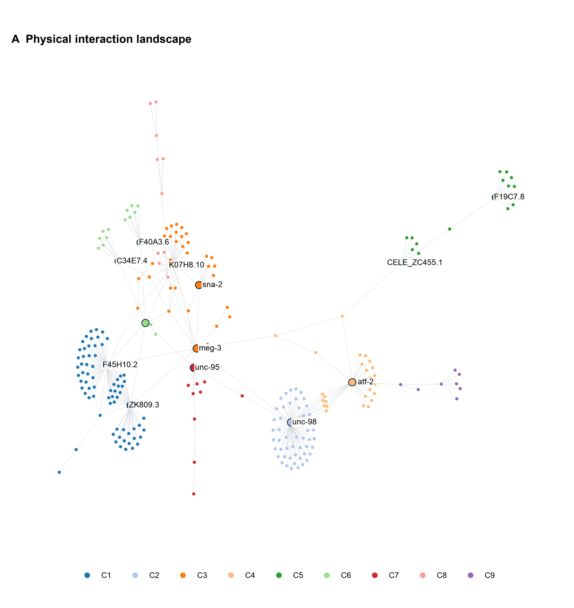
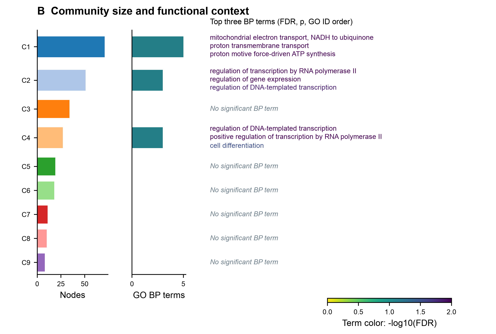
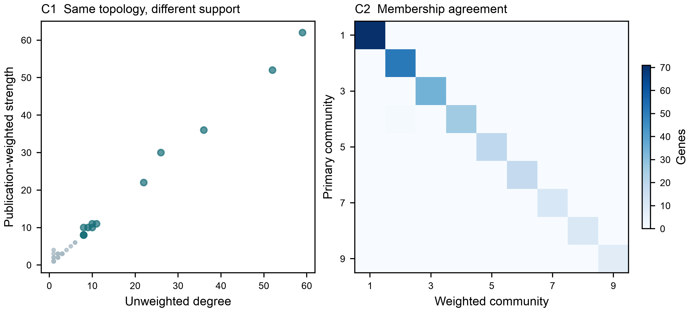

# End-to-end demonstration: 100 historical input records

**This demonstration contains only a sample of a dataset that will be published in full at a later date.** It is separate from the current 429-WBGene study. The remaining historical input records and the 429-study results are not distributed here.

The example was recalculated through all six stages, using 100 sampled rows from the historical 165-row input. These represent **76 unique WBGene IDs, 100 UniProt accessions and 76 recovered orthogroups**. Several protein accessions map to the same gene: the network correctly uses one node per WBGene, not one node per input row.

## Input selection and database snapshots

[Input TSV](input.tsv) contains exactly 100 data rows. Selection uses Python `random.Random(20260806).sample(range(165), 100)`, then restores original row order. Sampling was not conditioned on phenotype, degree or hub status. [Selection metadata](selection.json) records the source checksum and selected row positions; it does not include the other 65 input records.

**WormBase uses a snapshot retrieved on 5 August 2026 at 09:44:02 UTC.** Its original release label is “live REST snapshot”; a numbered WormBase release was not established. Snapshot retrieval date is not a claim about the underlying database release or record cache date. Only the 13 archived hub responses used by this demonstration are distributed in [wormbase_snapshot](wormbase_snapshot/manifest.json), byte-for-byte with SHA-256 verification. No live WormBase query was made for the demonstration. All 13 resulting hubs happen to be covered by this archive; genes outside that coverage would remain explicitly missing.

The other sources are **not** presented as an August WormBase release: BioGRID 5.0.262 was retrieved on 15 October 2026; NCBI mappings and Bgee 15.2 on 16 October; GO uses the documented August GAF/July OBO snapshots. Human similarity was recalculated with BLASTP 2.17.0+ and UniProt 2026_03. Exact source metadata and checksums are in [resources.json](resources.json) and source-specific result manifests.

## What the pipeline produced

| Stage | Demonstration result |
|---|---|
| 01 — Physical interactions | Both partners restricted to C. elegans; identifiers and evidence QC saved |
| 02 — Network | Full graph: 344 nodes / 331 edges; LCC: 249 nodes / 287 edges |
| 03 — Topology and hubs | 9 primary communities; 13 robust hubs; weighted sensitivity retained |
| 04 — GO | 230 annotated LCC genes; 11 significant community–BP associations across 3 communities |
| 05 — Biological evidence | WormBase: 380 observed/not-observed records for 13 hubs; Bgee: 582 condition records for 13 hubs; BLAST: 1,522 query–subject pairs |
| 06 — Integrated profiles | 13 candidate profiles, network/community/sensitivity figures, English HTML report |

The LCC includes 25 original input genes and their external partners. Its size can therefore exceed the number of input genes. Hubs are selected across that LCC, not restricted to input membership. Five hubs have qualifying human sequence-similarity hits; eight have no qualifying hit under the configured search. This is not proof of orthology or absence of homology.

### Network and communities



### Community functional context



### Sensitivity analysis



## Explore the results

- [English HTML report](results/06_target_profiles/analysis_report.html): download and open locally; GitHub displays HTML source rather than running the report. Figures are embedded; keep the result folders together for TSV links.
- [Integrated hub profiles](results/06_target_profiles/candidate_target_profiles.tsv).
- [All LCC node metrics](results/03_network_analysis/node_metrics.tsv).
- [Complete GO results](results/04_functional_context/go_enrichment.tsv).
- [Detailed WormBase phenotype evidence](results/05_biological_evidence/wormbase/phenotypes.tsv), with observed/not-observed flags, experimental evidence and WBPaper references.
- [WormBase hub coverage](results/05_biological_evidence/wormbase/candidate_summary.tsv) and [independent source statuses](results/05_biological_evidence/evidence_status.tsv).

Observed and explicitly not-observed phenotypes remain separate. Evidence must be interpreted in its experimental context; no automatic essentiality classification or composite target score is generated. Snapshot coverage is not a biological negative result.

## Reproduce the presentation offline

After installing the repository requirements, run from the repository root:

```bash
python examples/demo100/render_saved_results.py
```

This regenerates figures and HTML from the distributed processed results into `local/demo100-rendered/`, with no database queries and no recalculation of network statistics. Choose a new `--output` directory for each rendering; existing directories are not overwritten. The raw whole-database downloads and BLAST database are intentionally not bundled.

## Recalculate all six stages

To reuse your own locally available, checksum-pinned resources:

```bash
python examples/demo100/run_demo.py --resources-config config/config.yaml
```

The resource configuration must point to valid pinned BioGRID/NCBI/GO/Bgee/human-proteome files. It supplies resource locations; the runner uses the published scientific settings in `parameters.json` and overrides the input with this 100-row sample and WormBase with the bundled archive. The main study's configuration/results remain untouched. UniProt query sequence retrieval still requires network access; BLAST+ must be installed.

From a fresh clone with no database snapshots:

```bash
python examples/demo100/run_demo.py --refresh
```

This acquires current external sources into an isolated workspace, while **WormBase remains frozen to the explicitly configured 5 August snapshot**. Updated databases can change network results and hub coverage; this command is a new analysis, not a promise of exact numerical agreement. For exact inspection of the published demonstration, use the distributed tables and offline rendering above. Neither command modifies the 429-WBGene study. A machine-readable checksum inventory is included in `CHECKSUMS.tsv`.

## Scope and licensing

The software is MIT-licensed. Database-derived evidence retains its upstream terms and attribution; the code license does not relicense WormBase, BioGRID, GO, Bgee or UniProt data. This public demonstration includes only the authorized sample and results derived from it. The complete underlying investigator dataset is planned for later publication.
